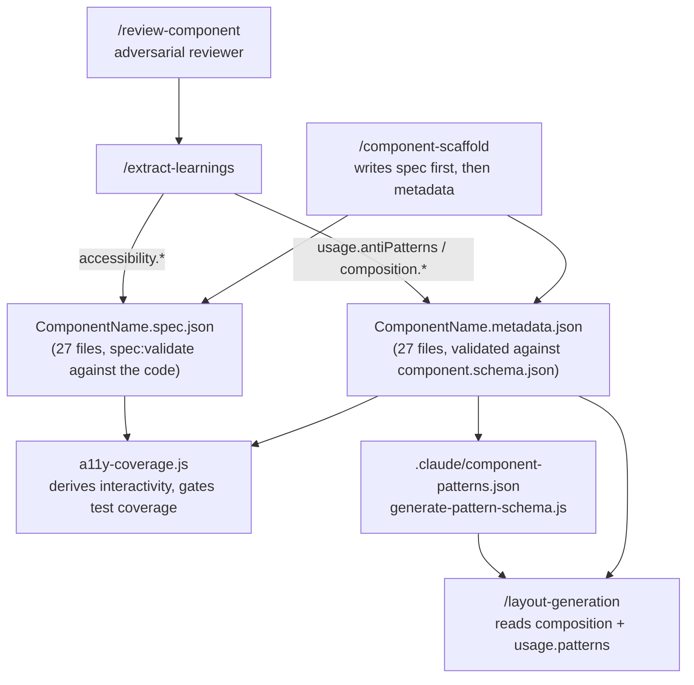

# Machine-readable metadata

## What it is

Every component ships a `<Name>.metadata.json` file — a structured fact sheet covering its purpose, usage guidance, variants, and its place in the component graph. Its sibling `<Name>.spec.json`, the [component spec](08-glossary.md), holds what only the builders read: anatomy (the component's named parts), props, states, the accessibility contract, and `styles`, the design tokens each part uses ([ADR-027](decisions/027-component-spec-file.md)). The `states`, `tokens` and `accessibility` sections moved from metadata to the spec on 2026-10-11 (see the ADR-001 amendments). This page covers the metadata file; the spec's checks are summarized below. That per-component contract is the base of a four-layer stack: a schema validates it, a scanner aggregates all 27 files into a cross-component index, and three downstream consumers (a11y coverage, layout generation, and the learnings loop) read from it instead of from implementation code. The point of the stack is that an agent — or a developer — can generate or verify a component without reading its `index.tsx`.

| Layer | Files | Producer | Consumers | CI gate | ADR |
|---|---|---|---|---|---|
| Per-component contract | `<Name>.metadata.json` (27 files) + `component.schema.json`, beside `<Name>.spec.json` + `component.spec.schema.json` | Component author, via `/component-scaffold` or hand-edit; `npm run spec:generate` drafts a spec from code | `/component-scaffold`, `/layout-generation`, `a11y-coverage.js`, `/extract-learnings` | `metadata:validate` in `components-check.yml` | [001](decisions/001-component-metadata-schema.md) |
| Validation | `scripts/validate-metadata.js`, `scripts/validate-spec.js` | Scripts (Ajv, draft 2020-12) | Every moment that trusts a metadata file is well-formed and a spec matches the code | `metadata:validate` and `spec:validate` in `components-check.yml` | [001](decisions/001-component-metadata-schema.md), [027](decisions/027-component-spec-file.md) |
| Cross-component aggregate | `.claude/component-patterns.json` | `scripts/generate-pattern-schema.js` (`npm run patterns:generate`) | `/layout-generation` only | Staleness check (regenerate + `git diff --exit-code`) in `components-check.yml` | [013](decisions/013-cross-component-pattern-schema.md) |
| Downstream consumers | a11y coverage derivation, layout citations, `/extract-learnings` write-back | `scripts/a11y-coverage.js`, `/layout-generation`, `/extract-learnings` | Developers and agents building pages and tests | `a11y:coverage` in `components-check.yml` | [008](decisions/008-behavioral-a11y-tier.md) |

## Why it's built this way

### `usage.antiPatterns` carries implementation constraints, not just usage advice

The schema requires all three fields of an anti-pattern — `scenario`, `reason`, `alternative` — because partial guidance isn't useful to an agent (ADR-001). In practice the field does more than warn against misuse: several of Accordion's anti-patterns document a hard-won implementation constraint (the `aria-controls`/always-mounted-panel rule below is one). `packages/components/AGENTS.md`'s type-enforced anti-pattern rule tightens this further — when a constraint is a hard "never do X," the component's prop type must make the violation a compile error (a narrowed `Omit<...>` on the spread native-attributes type), not just a documented warning. The metadata is the source the type narrowing is checked against.

### The token list is derived, never written

A component's token list is no longer written by hand: it is the set of tokens its spec's `styles` reference, and `spec:validate` checks that set against the code. (Metadata no longer carries a `tokens.*` list.) The set must equal the `var(--ds-*)` [CSS custom properties](08-glossary.md) the component's stylesheet (its CSS Module) reads (plus reads in `index.tsx`, such as the `` var(--ds-size-avatar-${size}) `` template), and every one must be defined in the built token CSS. A component can't reference a token that was renamed or never existed, and a token a child `Text`, `Icon` or `Stack` applies belongs to that child's spec.

The hand-written list caused 8 of the 12 gate retries in the harness ablation's full-harness arm: the scaffold listed tokens it saw rendered, not the ones its own files read. A stopgap script derived the list from the CSS (ADR-029 Step 5). The spec rollout made it unnecessary: with every component on a spec, the list exists only as the spec's `styles`, so there's nothing to keep in step, and the script was deleted (ADR-001 amendment 2026-10-11). Readers that still want a grouped token list, such as the Airtable component push, get one from `readComponentMetadata` in `scripts/lib.js`, which merges the spec's tokens and `accessibility` back into the metadata object.

### `composition` is a machine-checkable graph because layout generation has to cite it

The same graph goes one level down for components with subcomponents. An optional `composition.parts` list declares each part (`CardVertical.Body`, `CardVertical.Action`, …) with its own `accepts` and `containedBy`, so a composed card can be checked the same way a page layout is ([ADR-023](decisions/023-subcomponents-compound-components.md); the block is shown below).

`composition.accepts`/`containedBy` (the section was renamed from ADR-001's original `relationships` when `compositionPatterns` moved to `usage.patterns` and `neverPairWith` was absorbed into `usage.antiPatterns` — see ADR-001's 2026-07-23 amendment) encode which components are valid parents and children. `/layout-generation` must cite one of these fields, plus `usage.patterns`, for every structural choice it makes (see [Layout grammar](04-layout-grammar.md)) — a graph an agent can walk beats prose it has to interpret.

### The cross-component aggregate exists, but stays layout-only

`.claude/component-patterns.json` buckets all 27 components into 10 interaction patterns and records a `drift[]` list where observed JSX disagrees with declared metadata. It was gated on a measured result, not intuition: ADR-013's harness found feeding it into every generation task improved layout/composition tasks but worsened component scaffolds, so it's wired into `/layout-generation` only — see [Rejected alternatives](case-study-source/04-rejected-alternatives.md) for the fuller telling and [Context engineering](09-context-engineering.md) for the "measure, don't assert" principle it's the worked example of.

### Interactivity is derived, not declared twice

`a11y-coverage.js` doesn't add an `isInteractive` field to the schema. It derives the fact from data the two files already require. A component counts as interactive if any one of three things holds: its metadata `component.type` is `interactive` or `input`; its spec's `accessibility.role` is on the script's list of interactive ARIA roles; or its spec declares a `keyboardInteractions` entry beyond plain Tab. (The script reads the spec fields through `readComponentMetadata`.) That keeps the schema from growing a redundant flag that could drift from the fields it would be summarizing, and it means declaring a keyboard interaction in the spec has a real consequence: the component now owes a behavioral `<Name>.a11y.test.tsx`, or the gate fails (see [Accessibility](03-accessibility.md)). The derivation lives in `scripts/lib.js` as `isInteractive`, and `npm run component:risk` uses the same function to decide whether `/add-component` spawns the adversarial reviewer (ADR-029). The same fields therefore decide both the a11y test obligation and the review path.

### The write-back loop makes metadata the system's memory

`/extract-learnings` reads a component's `.review.json` after an adversarial review and routes each finding to a specific sub-field — ARIA findings to the spec's `accessibility.ariaAttributes`, keyboard findings to the spec's `accessibility.keyboardInteractions`, and in metadata, consumer misuse to `usage.antiPatterns`, parent/child mistakes to `composition.accepts`/`containedBy` (see [Agentic moments](06-agentic-moments.md)). A bug fixed only in code rots the next time someone reads the metadata or spec instead of the implementation; fixed there, it becomes something the next scaffold or layout generation can't repeat.

## How it works, concretely

A trimmed anti-pattern from `Accordion.metadata.json` — it encodes an ARIA constraint that would otherwise have to be rediscovered by reading the implementation:

```json
{
  "scenario": "Conditionally rendering the panel element (e.g. {isOpen && <div>}) instead of always mounting it",
  "reason": "aria-controls on the trigger must point to an element that is always in the DOM. Unmounting the panel when closed means the target id does not exist in the collapsed state, breaking the ARIA association for screen readers such as NVDA + Firefox.",
  "alternative": "Always render the panel div. ... pair aria-hidden={!isOpen} with the panel element's inert DOM property ..."
}
```

A `composition.parts` block declares a component's subcomponents (ADR-023). Each part has a `kind`: `fixed` (content and state props only), `slot` (exactly one child from `accepts`) or `open` (any children from `accepts`, laid out by the primitive named in `builtOn`). An abridged sketch of the shape CardVertical will use:

```json
"parts": [
  { "name": "Action", "kind": "slot", "description": "Top-right overlay; one Favorite or one Menu.", "builtOn": null, "accepts": ["Favorite", "Menu"], "containedBy": ["Media"] },
  { "name": "Body", "kind": "open", "description": "Text column under the media.", "builtOn": "Stack", "accepts": ["Title", "Meta", "Stack", "Inline", "Text", "Badge", "Avatar"], "containedBy": ["Root"] },
  { "name": "Title", "kind": "fixed", "description": "Card heading; names the card.", "builtOn": "Heading", "required": true, "containedBy": ["Body"] }
]
```

`scripts/validate-metadata.js` runs three checks beyond the Ajv schema pass. The schema itself rejects a metadata file that still carries `states`, `tokens` or `accessibility`, and the error says where the section went.

- `component.name` must equal the containing directory name.
- Every `composition.parts` entry must be internally consistent: names are unique and don't collide with a component name, `accepts` appears only on `slot`/`open` parts (and is required there), each `accepts` entry is a component or a sibling part, each `containedBy` entry is a sibling part, and `builtOn` is a component or `null`. "Component" means one exported by `@upskill/components` (`publicComponents()` in `scripts/lib.js`), the same list `layout:validate` uses (#98).
- Every `<Name>.spec.json` must parse as JSON. The full spec check is `spec:validate`, which needs built tokens and runs as its own CI step; the parse check keeps a malformed spec from passing the token-free local gate.

`scripts/validate-spec.js` (`npm run spec:validate`) checks each spec against `component.spec.schema.json` and then against the code: every prop in the props types is in the spec and vice versa, variant options match the TypeScript union and the metadata axis, the `styles` tokens match the code's reads (above), and internal references between states, constraints, anatomy and `composition.parts` resolve. Every component must have a spec, and a `TODO` left by `spec:generate` fails the check.

`scripts/validate-layout.js` then uses the same block to check layouts that compose a component from its parts.

`.claude/component-patterns.json`'s top level is `{ generatedFrom, architecturalStyle, patterns, drift }` — `patterns` keyed by the 10 buckets (`controlled-selection`, `disclosure`, `navigation`, `status-indicator`, `toggle-button`, `form-field`, `action-trigger`, `layout-primitive`, `static-display`, `content-stepper`), each holding a `description` and an `implementedBy` list. `architecturalStyle` is `flat-props` everywhere except components that attach parts (ADR-023): their own entry carries `architecturalStyle: "compound"` and their part names, and the top-level string lists them. The scanner reads `<CardVertical.Body>` as a use of `CardVertical`, never as a component of its own. One real `drift[]` entry:

```json
{
  "components": [
    "Badge"
  ],
  "detail": "Badge JSX uses [Text] but metadata composition.composedOf declares [].",
  "issue": "composition-metadata-mismatch",
  "pattern": "static-display"
}
```

`drift[]` also checks prop names against the prop vocabulary ([ADR-026](decisions/026-component-prop-vocabulary.md)). Every `on<X>Change` callback needs an `x` prop, every `default<X>` needs both `x` and `on<X>Change`, and a selection component never carries a `selected*` prop. That is how `selectedValue` on `DropdownMenu` was caught. Components may use different callback names, because each callback is named after its own state (`onOpenChange`, `onValueChange`, `onPressedChange`).

The consumption map — which command reads which section for what:

- `/component-scaffold` reads both schemas, an existing component's metadata and spec as templates, and Figma design context — it *produces* the new spec (first, from the approved API proposal) and metadata rather than consuming them.
- `/layout-generation` reads `composition.accepts`/`containedBy` (plus `composition.parts` when composing a component from its parts), `usage.patterns`, and (layout/composition tasks only) `component-patterns.json`. It never reads specs.
- `a11y-coverage.js` derives "interactive" from `component.type` and the spec's `accessibility.role` and `accessibility.keyboardInteractions`, and fails the build if an interactive component has no behavioral a11y test.
- `/extract-learnings` writes back into the spec's `accessibility.*` and metadata's `usage.antiPatterns` and `composition.*`.

`component.category` and `component.type` are the one place the schema enforces a closed taxonomy (`atom|molecule|organism|layout` and `interactive|display|container|input`) — every other section is free-text within its shape. That's deliberate: those two fields are load-bearing for both `a11y-coverage.js`'s interactivity derivation and `generate-pattern-schema.js`'s bucketing fallback (`layout-primitive` when structural detection finds nothing else), so an unenforced vocabulary there would quietly break two downstream consumers at once.

## Diagram



## Related

- Docs: [Component lifecycle](02-component-lifecycle.md), [Accessibility](03-accessibility.md), [Layout grammar](04-layout-grammar.md), [Agentic moments](06-agentic-moments.md), [Context engineering](09-context-engineering.md)
- ADRs: [001 — Component metadata schema](decisions/001-component-metadata-schema.md) (+ amendments), [027 — Component spec file](decisions/027-component-spec-file.md), [008 — Behavioral a11y tier](decisions/008-behavioral-a11y-tier.md), [013 — Cross-component pattern schema](decisions/013-cross-component-pattern-schema.md) (+ amendment), [023 — Subcomponents](decisions/023-subcomponents-compound-components.md)
- Scripts: `npm run metadata:validate`, `npm run spec:validate`, `npm run spec:generate`, `npm run patterns:generate`, `npm run a11y:coverage` — see the [CLI reference](07-cli-reference.md)
