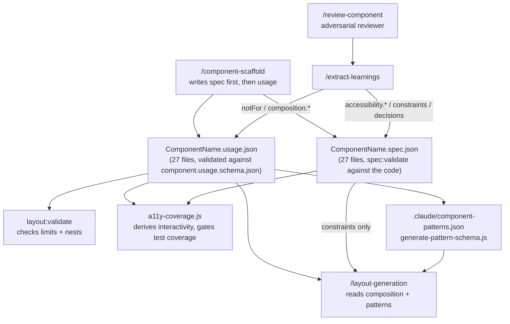

# Machine-readable metadata

## What it is

Every component ships a `<Name>.usage.json` file — a structured fact sheet saying when to use the component, what not to use it for, when to use each variant option, and how it composes with the rest of the library. Until 2026-11-10 it was called `<Name>.metadata.json`; it was renamed and relabelled around composition, which is the hard part of using this library (ADR-001 amendment 2026-11-10). Its sibling `<Name>.spec.json`, the [component spec](08-glossary.md), holds how the component is built: anatomy (the component's named parts), props, the rules for combining props (`constraints`), states, the accessibility contract, and `styles`, the design tokens each part uses ([ADR-027](decisions/027-component-spec-file.md)). The `states`, `tokens` and `accessibility` sections moved there on 2026-10-11 (see the ADR-001 amendments). This page covers the usage file; the spec's checks are summarized below. That per-component contract is the base of a four-layer stack: a schema validates it, a scanner aggregates all 27 files into a cross-component index, and three downstream consumers (a11y coverage, layout generation, and the learnings loop) read from it instead of from implementation code. The point of the stack is that an agent — or a developer — can generate or verify a component without reading its `index.tsx`.

| Layer | Files | Producer | Consumers | CI gate | ADR |
|---|---|---|---|---|---|
| Per-component contract | `<Name>.usage.json` (27 files) + `component.usage.schema.json`, beside `<Name>.spec.json` + `component.spec.schema.json` | Component author, via `/component-scaffold` or hand-edit; `npm run spec:generate` drafts a spec from code | `/component-scaffold`, `/layout-generation`, `a11y-coverage.js`, `/extract-learnings` | `usage:validate` in `components-check.yml` | [001](decisions/001-component-metadata-schema.md) |
| Validation | `scripts/validate-usage.js`, `scripts/validate-spec.js` | Scripts (Ajv, draft 2020-12) | Every moment that trusts a usage file is well-formed and a spec matches the code | `usage:validate` and `spec:validate` in `components-check.yml` | [001](decisions/001-component-metadata-schema.md), [027](decisions/027-component-spec-file.md) |
| Cross-component aggregate | `.claude/component-patterns.json` | `scripts/generate-pattern-schema.js` (`npm run patterns:generate`) | `/layout-generation` only | Staleness check (regenerate + `git diff --exit-code`) in `components-check.yml` | [013](decisions/013-cross-component-pattern-schema.md) |
| Downstream consumers | a11y coverage derivation, layout citations, `/extract-learnings` write-back | `scripts/a11y-coverage.js`, `/layout-generation`, `/extract-learnings` | Developers and agents building pages and tests | `a11y:coverage` in `components-check.yml` | [008](decisions/008-behavioral-a11y-tier.md) |

## Why it's built this way

### Each "don't" lives where its reader looks

Until 2026-11-10 every "don't" was one `usage.antiPatterns` list: 106 entries mixing four kinds of rule with four different readers. The audit behind the rename sorted them, and each kind now has its own home:

| Kind | Example | Home | Checked by |
|---|---|---|---|
| Wrong pick | Badge used as a toggleable filter → use Chip | `usage.json` `notFor`, with `instead` naming the component | `usage:validate` (that `instead` exists) |
| Countable composition rule | At most one accent Button per region, none inside a repeated item | `usage.json` `composition.limits` | `layout:validate` |
| Self-nesting | Card inside Card | `usage.json` `composition.nests: false` | `layout:validate` |
| Other composition don't | Mixing Card, CardVertical and CardHorizontal in one section | `usage.json` `composition.donts` (`case`, `because`, `instead`) | Read by `/layout-generation` |
| Prop rule | Accordion `open` together with `defaultOpen` | spec `constraints` | `spec:validate` lists unenforced ones as backlog |
| How it's built | Accordion's panel is always mounted | spec `decisions` | Read by `/review-component` |

Rules something else already enforced (the inline-style ban, a `label` the types require, a parent `containedBy` already excludes) were deleted rather than moved. Every entry still says *why*: partial guidance isn't useful to an agent (ADR-001). `packages/components/AGENTS.md`'s type-enforced rule still applies: when a constraint is a hard "never do X," the prop type must make the violation a compile error (a narrowed `Omit<...>` on the spread native-attributes type), not just a documented warning.

### The token list is derived, never written

A component's token list is no longer written by hand: it is the set of tokens its spec's `styles` reference, and `spec:validate` checks that set against the code. (Metadata no longer carries a `tokens.*` list.) The set must equal the `var(--ds-*)` [CSS custom properties](08-glossary.md) the component's stylesheet (its CSS Module) reads (plus reads in `index.tsx`, such as the `` var(--ds-size-avatar-${size}) `` template), and every one must be defined in the built token CSS. A component can't reference a token that was renamed or never existed, and a token a child `Text`, `Icon` or `Stack` applies belongs to that child's spec.

The hand-written list caused 8 of the 12 gate retries in the harness ablation's full-harness arm: the scaffold listed tokens it saw rendered, not the ones its own files read. A stopgap script derived the list from the CSS (ADR-029 Step 5). The spec rollout made it unnecessary: with every component on a spec, the list exists only as the spec's `styles`, so there's nothing to keep in step, and the script was deleted (ADR-001 amendment 2026-10-11). Readers that still want a grouped token list, such as the Airtable component push, get one from `readComponentUsage` in `scripts/lib.js`, which merges the spec's tokens and `accessibility` back into the usage object.

### `composition` is a machine-checkable graph because layout generation has to cite it

The same graph goes one level down for components with subcomponents. An optional `composition.parts` list declares each part (`CardVertical.Body`, `CardVertical.Action`, …) with its own `accepts` and `containedBy`, so a composed card can be checked the same way a page layout is ([ADR-023](decisions/023-subcomponents-compound-components.md); the block is shown below).

`composition.accepts`/`containedBy` (the section was renamed from ADR-001's original `relationships` — see ADR-001's 2026-07-23 amendment) encode which components are valid parents and children. `composition.width` says whether the component fills its container or hugs its content, `nests` whether it may sit inside itself, and `limits` how many of a given variant a region, repeated item or parent may hold. `/layout-generation` must cite one of these fields, or a named entry in `composition.patterns`, for every structural choice it makes (see [Layout grammar](04-layout-grammar.md)) — a graph an agent can walk beats prose it has to interpret, and a count `layout:validate` can check beats a rule it can only read. No other system compared in the audit (Carbon, GOV.UK, Atlassian, shadcn, the Custom Elements Manifest) has a richer vocabulary for this; Carbon and Nathan Curtis's work on Figma slots are where counts as data come from.

### The cross-component aggregate exists, but stays layout-only

`.claude/component-patterns.json` buckets all 27 components into 10 interaction patterns and records a `drift[]` list where component code disagrees with the prop vocabulary. It was gated on a measured result, not intuition: ADR-013's harness found feeding it into every generation task improved layout/composition tasks but worsened component scaffolds, so it's wired into `/layout-generation` only — see [Rejected alternatives](case-study-source/04-rejected-alternatives.md) for the fuller telling and [Context engineering](09-context-engineering.md) for the "measure, don't assert" principle it's the worked example of.

### Interactivity is derived, not declared twice

`a11y-coverage.js` doesn't add an `isInteractive` field to the schema. It derives the fact from data the two files already require. A component counts as interactive if any one of three things holds: its usage file's `component.type` is `interactive` or `input`; its spec's `accessibility.role` is on the script's list of interactive ARIA roles; or its spec declares a `keyboardInteractions` entry beyond plain Tab. (The script reads the spec fields through `readComponentUsage`.) That keeps the schema from growing a redundant flag that could drift from the fields it would be summarizing, and it means declaring a keyboard interaction in the spec has a real consequence: the component now owes a behavioral `<Name>.a11y.test.tsx`, or the gate fails (see [Accessibility](03-accessibility.md)). The derivation lives in `scripts/lib.js` as `isInteractive`, and `npm run component:risk` uses the same function to decide whether `/add-component` spawns the adversarial reviewer (ADR-029). The same fields therefore decide both the a11y test obligation and the review path.

### The write-back loop makes the usage and spec files the system's memory

`/extract-learnings` reads a component's `.review.json` after an adversarial review and routes each finding to a specific sub-field — ARIA findings to the spec's `accessibility.ariaAttributes`, keyboard findings to `accessibility.keyboardInteractions`, prop rules to `constraints`, and in the usage file, wrong picks to `notFor`, parent/child mistakes to `composition.accepts`/`containedBy`, composition mistakes to `composition.donts` or `limits` (see [Agentic moments](06-agentic-moments.md)). A bug fixed only in code rots the next time someone reads the usage file or spec instead of the implementation; fixed there, it becomes something the next scaffold or layout generation can't repeat.

## How it works, concretely

Button's `composition`, abridged from `Button.usage.json`. The two limits are what `layout:validate` checks; the patterns are names whose code is in `Button.patterns.stories.tsx`:

```json
"composition": {
  "containedBy": ["Box", "Stack", "Inline", "Card"],
  "width": "hug",
  "nests": false,
  "limits": [
    { "if": { "variant": "accent" }, "max": 1, "per": "region", "because": "Variants are absolute weights: the region's one decision gets accent ... (ADR-024)." },
    { "if": { "variant": "accent" }, "max": 0, "per": "repeated", "because": "N repeated items would render N competing primaries ..." }
  ],
  "patterns": [
    { "name": "form-actions", "useWhen": "A form or dialog ends in one decision: confirm it or cancel it." },
    { "name": "destructive-confirm", "useWhen": "The decision deletes or irreversibly changes something, and the user confirms it." }
  ]
}
```

A `composition.parts` block declares a component's subcomponents (ADR-023). Each part has a `kind`: `fixed` (content and state props only), `slot` (exactly one child from `accepts`) or `open` (any children from `accepts`, laid out by the primitive named in `builtOn`). An abridged sketch of the shape CardVertical will use:

```json
"parts": [
  { "name": "Action", "kind": "slot", "description": "Top-right overlay; one Favorite or one Menu.", "builtOn": null, "accepts": ["Favorite", "Menu"], "containedBy": ["Media"] },
  { "name": "Body", "kind": "open", "description": "Text column under the media.", "builtOn": "Stack", "accepts": ["Title", "Meta", "Stack", "Inline", "Text", "Badge", "Avatar"], "containedBy": ["Root"] },
  { "name": "Title", "kind": "fixed", "description": "Card heading; names the card.", "builtOn": "Heading", "required": true, "containedBy": ["Body"] }
]
```

`scripts/validate-usage.js` runs these checks beyond the Ajv schema pass. The schema itself rejects a usage file that still carries `states`, `tokens`, `accessibility` or the old `usage` section, and the error says where it went.

- `component.name` must equal the containing directory name.
- Every `composition.parts` entry must be internally consistent: names are unique and don't collide with a component name, `accepts` appears only on `slot`/`open` parts (and is required there), each `accepts` entry is a component or a sibling part, each `containedBy` entry is a sibling part, and `builtOn` is a component or `null`. "Component" means one exported by `@upskill/components` (`publicComponents()` in `scripts/lib.js`), the same list `layout:validate` uses (#98).
- Every `notFor.instead` is a component (or `null` with a `note` naming the alternative outside the library); every `composition.limits[].if` names a real variant axis and option; every `variants.<axis>.useWhen` key is an option of that axis; every `composition.patterns[].name` is unique across the set, since the story export, the Figma example frame and `spec.anatomyExamples` share it.
- No `<Name>.metadata.json` is left behind.
- Every `<Name>.spec.json` must parse as JSON. The full spec check is `spec:validate`, which needs built tokens and runs as its own CI step; the parse check keeps a malformed spec from passing the token-free local gate.

`scripts/validate-spec.js` (`npm run spec:validate`) checks each spec against `component.spec.schema.json` and then against the code: every prop in the props types is in the spec and vice versa, variant options match the TypeScript union and the usage file's axis, the `styles` tokens match the code's reads (above), internal references between states, constraints, anatomy and `composition.parts` resolve, and prop names follow the prop vocabulary (below). Every component must have a spec, and a `TODO` left by `spec:generate` fails the check.

Three optional spec sections serve the generated docs pages and the Figma parity check ([ADR-030](decisions/030-spec-renderers.md)):
- `anatomyExamples` lists the examples that together render every part. Each entry is root props, or the name of a `composition.patterns` entry in the usage file for compositions written in JSX.
- `decisions` records per-component choices too small for an ADR.
- `ruledOut` records options considered and rejected, so nobody proposes them again without new evidence.

`spec:validate` checks that example props and patterns exist, and that every `adr` a decision cites has a file in `docs/decisions/` ([ADR-027](decisions/027-component-spec-file.md) amendment 2026-11-10).

Each anatomy part is marked in the rendered HTML with `data-part="<name>"`, and `npm run anatomy:test` renders the examples to check that every part is marked. Two optional anatomy fields cover the exceptions:
- `builtOnPart` handles a part rendered inside a nested library component. CardVertical's `FavoriteGlyph` is Button's own `Icon` part.
- `notRendered` gives the reason no example can render a part. CardVertical's `MenuPanel` only appears after the menu opens.

`scripts/validate-layout.js` then uses the same block to check layouts that compose a component from its parts.

`.claude/component-patterns.json`'s top level is `{ generatedFrom, architecturalStyle, patterns, drift }` — `patterns` keyed by the 10 buckets (`controlled-selection`, `disclosure`, `navigation`, `status-indicator`, `toggle-button`, `form-field`, `action-trigger`, `layout-primitive`, `static-display`, `content-stepper`), each holding a `description` and an `implementedBy` list. `architecturalStyle` is `flat-props` everywhere except components that attach parts (ADR-023): their own entry carries `architecturalStyle: "compound"` and their part names, and the top-level string lists them. The scanner reads `<CardVertical.Body>` as a use of `CardVertical`, never as a component of its own. `drift[]` is empty today. Until 2026-11-10 it also compared the JSX with a hand-written `composition.composedOf` list; that field was dropped because the scanner already reads the JSX, so the list could only drift.

`drift[]` checks prop names against the prop vocabulary ([ADR-026](decisions/026-component-prop-vocabulary.md)). Every `on<X>Change` callback needs an `x` prop, every `default<X>` needs both `x` and `on<X>Change`, and a selection component never carries a `selected*` prop. That is how `selectedValue` on `DropdownMenu` was caught. Components may use different callback names, because each callback is named after its own state (`onOpenChange`, `onValueChange`, `onPressedChange`). Since 2026-11-10 the same rules, plus banned names and prefixes, `false`-default booleans, collection names, axis values and Figma names, also **block** in `spec:validate` (`scripts/prop-vocabulary.js`, [ADR-026](decisions/026-component-prop-vocabulary.md) amendment). Known exceptions are listed by id in `scripts/prop-vocabulary-waivers.json`, a ledger that only shrinks.

### Who reads which field

The two files are split by reader. The usage file is for **picking and composing** a component, the spec is for **building and reviewing** it, and the renderers only display both. Before adding a field, find its reader in this table. A field nobody reads costs tokens on every `/layout-generation` run and can drift without anyone noticing (`usage.keywords` was dropped on 2026-11-10 for that reason).

| Reader | Kind | From `usage.json` | From `spec.json` | What for |
|---|---|---|---|---|
| `/component-scaffold` (Stage 1 of `/add-component`) | Writer | Writes it after the spec | Writes it first, from the approved API proposal | A new component's contract, written before the code. The closest existing pair is read as a template. |
| `/layout-generation` | Picker / composer | Every file, whole: `composition` (incl. `parts`, `limits`, `donts`, `patterns`), `notFor`, each option's `useWhen`; a `<Name>.patterns.stories.tsx` only for a pattern it picks | `constraints` only | Choosing components and citing a field for every structural choice |
| `layout:validate` (`validate-layout.js`) | Gate | `composition.nests`, `composition.limits`, and `composition.parts` (each part's `accepts`, `containedBy`, `required`) | — | Checking a layout file against the composition graph. The component-level `accepts`/`containedBy` are not checked (see the audit below). |
| `/review-component` | Builder check | — | The whole spec, as the intent the code is held to: each `anatomy` role and `action` against the markup, `constraints` against their `enforcedBy`, `states` against the CSS and handlers | Findings that `spec:validate` can't produce |
| `spec:validate` (`validate-spec.js`) | Gate | `variants` (options must match the spec's props) | Every section, against the code and the built tokens | Keeping the spec and the code in step |
| `usage:validate` (`validate-usage.js`) | Gate | Every section, against the schema and the fixed set | Parse check only | Keeping the usage file well-formed |
| `anatomy:test` | Gate | — (a pattern example renders the story named after the pattern) | `anatomy`, `anatomyExamples` | Every part renders with its `data-part` marker |
| `a11y-coverage.js` | Gate | `component.type` | `accessibility.role`, `accessibility.keyboardInteractions` | Deriving "interactive" and requiring a behavioral a11y test |
| `generate-pattern-schema.js` | Aggregator | `component.type`, `component.status`, `composition.parts` | `accessibility.notes`, `accessibility.ariaAttributes` | Building `.claude/component-patterns.json` (with the JSX scan) |
| `airtable-sync.js` | Governance push | `component` (incl. `status`, `figmaNodeId`), `variants` | `styles` tokens, through `readComponentUsage` | The Airtable component table (ADR-010) |
| `spec-bundle.js` → docs component pages | Renderer | `component`, `useWhen`, `notFor`, `variants`, `composition` | `anatomy`, `anatomyExamples`, `props`, `constraints`, `states`, `accessibility`, `styles`, `figma`, `decisions`, `ruledOut` | Generated pages: the anatomy overlay drawn on rendered examples, a parts tree and a parts table ([ADR-030](decisions/030-spec-renderers.md)) |
| Figma parity plugin (planned, ADR-030 Part B) | Renderer | Through `specs.bundle.json` | Through `specs.bundle.json` | Flagging differences between Figma and the spec |
| `spec:generate` (`generate-spec.js`) | Writer | `composition.parts` | Drafts every section from existing code | Backfilling specs only, never a new component |
| `/extract-learnings` | Writer | Writes `notFor`, `composition.*` | Writes `accessibility.*`, `constraints`, `decisions` | Turning review findings into durable rules |

`anatomy` is builder context, not only renderer input. The scaffold writes it before any code, the code marks each part with `data-part`, `anatomy:test` checks the markers, and the reviewer checks each part's role. The docs diagram reuses the same data. `anatomyExamples` is the one section that exists mainly for display, but `anatomy:test` renders the same examples, so it stays in the spec.

### What scripts read deterministically (audit 2026-11-10)

The case for keeping the contracts as JSON rests on which fields code reads, not on how well a model reads JSON. Research on prompt formats doesn't settle that question: results vary by model and task, and Markdown's clearest advantage is fewer tokens, not better answers. So this audit traced every field to the scripts, tests and renderers that parse it. Agents are left out. Each field gets the strongest of four levels:

- **Gated:** a check compares the value with the code, another file, the fixed component set or the built tokens, and fails the build when they disagree.
- **Used:** a script derives something from the value or pushes it elsewhere, without checking it.
- **Rendered:** only the generated docs page reads it, and shows it as written.
- **None:** no code reads it beyond the schema's shape check. Only agents read it.

**`usage.json`**

| Field | Level | Read by |
|---|---|---|
| `component.name` | Gated | `usage:validate` (must equal the folder name) |
| `component.type` | Used | `isInteractive` → `a11y:coverage` (which test a component owes), `component:risk`, the pattern aggregate's fallback bucket |
| `component.status`, `component.figmaNodeId` | Used | `airtable-sync.js` (Maturity column, ADR-010); `generate-pattern-schema.js`, `sense-component.js` |
| `component.description`, `useWhen` | Rendered | Docs page |
| `notFor[].instead` | Gated | `usage:validate` (a fixed-set component, not the component itself; `null` needs a `note`) |
| `notFor[].case`, `because`, `note` | Rendered | Docs page |
| `composition.patterns[].name` | Gated | `usage:validate` (unique across the set; equal to the exports of `<Name>.patterns.stories.tsx`, PascalCase); `spec:validate` (an `anatomyExamples` pattern must exist); `anatomy:test` renders the story with that name |
| `composition.patterns[].useWhen` | Rendered | Docs page, linked to the pattern's story in `<Name>.patterns.stories.tsx`, which holds its code |
| `variants.<axis>.options`, `default` | Gated | `spec:validate` (must equal the spec prop and the TypeScript union); `usage:validate` (`limits` and `useWhen` keys must name options); `airtable-sync.js` |
| `variants.<axis>.useWhen` | Gated (keys) | `usage:validate` (each key is an option); the text is rendered |
| `composition.nests`, `composition.limits` | Gated | `layout:validate`; `usage:validate` checks the axis and option each limit names |
| `composition.parts` | Gated | `usage:validate`, `layout:validate`, `spec:validate` (must match `anatomy`), `generate-pattern-schema.js`, `spec:generate` |
| `composition.containedBy` | Rendered | Docs page ("Placed inside"). The names aren't validated. |
| `composition.donts` | Rendered | Docs page. Don'ts a check can't express, by design. |
| `composition.accepts`, `composition.width` | None | Agents only |

**`spec.json`**

| Field | Level | Read by |
|---|---|---|
| `component` | Gated | `spec:validate` (must equal the folder name) |
| `anatomy[].name`, `parent` | Gated | `spec:validate` (parents resolve, `styles` keys and `<Name>PartProps` types name parts); `anatomy:test` (a `data-part` marker per part) |
| `anatomy[].builtOn`, `builtOnPart`, `notRendered` | Gated | `spec:validate` (a fixed-set component, matches `composition.parts`, the host spec has that part); `anatomy:test` |
| `anatomy[].element`, `role`, `action`, `required`, `when`, `notes`, `builtOnProps` | Rendered | Docs page; `/review-component` checks `role` and `action` against the markup |
| `anatomyExamples` | Gated | `spec:validate` (props and patterns exist); `anatomy:test` renders each one |
| `props.<p>.kind`, `options`, `default` | Gated | `spec:validate` against the TypeScript props types and the code's defaults, and against `usage.json` variants |
| `props.<p>.figma` (`surface`, `property`) | Gated | `spec:validate` (figma-only props are skipped); `prop-vocabulary.js` (Figma name vs prop name, ADR-026) |
| `props.<p>.type` | Rendered | Docs page |
| `props.<p>.concept` | None | Written by `spec:generate` as a `TODO` that fails the check until filled. Nothing reads the content. |
| `constraints[].if`, `require`, `ignore`, `forbid` | Gated | `spec:validate` (every reference is a spec prop) |
| `constraints[].enforcedBy` | Used | `spec:validate` lists empty ones as backlog |
| `constraints[].reason` | Rendered | Docs page |
| `states[].name` | Gated | `spec:validate` (`styles` `when.state` must name one) |
| `states[].kind`, `trigger`, `notes` | Rendered | Docs page; `kind` is limited to the ADR-025 values by the schema |
| `accessibility.role`, `keyboardInteractions` | Used | `isInteractive` → `a11y:coverage`, `component:risk`, the bundle's a11y tier |
| `accessibility.ariaAttributes`, `notes` | Used | Copied into `component-patterns.json`; rendered |
| `styles` | Gated | `spec:validate` (token set = the CSS Module's `var(--ds-*)` reads, each defined in the built CSS; part and `when` keys resolve); `airtable-sync.js` via `readComponentUsage`; `spec-bundle.js` resolves each token's values |
| `figma.sets`, `figma.divergences` | Rendered | Docs page |
| `decisions[].adr` | Gated | `spec:validate` (the ADR file exists) |
| `decisions[].decision`, `reason`, `ruledOut` | Rendered | Docs page |

**Totals.** Of the 40 field groups above, 18 are gated and 6 are used by a script, so 24 depend on code parsing a fixed shape. Another 13 are rendered by the docs page, which needs the same stable structure. Only 3 have no code reader. In Markdown, every one of the 24 would need a parser that turns headings and lists back into values, with nothing to validate that parser. The prose is already confined to labelled string fields (`because`, `useWhen`, `notes`, `reason`), so an agent reads it as prose with the label saying what kind of statement it is. That is the case for keeping both contracts as JSON.

**Gaps the audit found.** None of these is fixed here; each needs its own decision:

- **`patterns[].tree` was never parsed.** Its 62 trees were written in a notation agents read, and a misspelled component name in one passed every check. Resolved by option D (ADR-001 second amendment, 2026-11-10): patterns became `{ name, useWhen }` and their code moved to type-checked stories, one export per pattern.
- **Component-level `accepts` and `containedBy` are unchecked.** `usage:validate` doesn't confirm their entries are components, and `layout:validate` checks containment only for `composition.parts`. They work only as citations for `/layout-generation`.
- **`composition.width` and `props.<p>.concept` have no code reader.** By the rule above, each should either get a reader (a check, or a column on the docs page) or be dropped, as `usage.keywords` was.

`component.type` is the one place the schema enforces a closed taxonomy (`interactive|display|container|input|layout`; the atomic-design `category` it used to sit beside was dropped on 2026-11-10, since only its `layout` value was ever read). Every other section is free-text within its shape. That's deliberate: the field is load-bearing for both `a11y-coverage.js`'s interactivity derivation and `generate-pattern-schema.js`'s bucketing fallback (`layout-primitive` when structural detection finds nothing else), so an unenforced vocabulary there would quietly break two downstream consumers at once.

### How a new component's spec gets written

`/component-scaffold` (Stage 1 of `/add-component`) writes the spec as a statement of intent, before any code exists. Each input has its own job:

| Input | Job |
|---|---|
| `component.spec.schema.json` | The shape: which sections exist and which values they allow (the prop `kind` enum, the ADR-025 state kinds). |
| Prop vocabulary (`packages/components/AGENTS.md`, [ADR-026](decisions/026-component-prop-vocabulary.md)) | The names. Each prop maps to a vocabulary concept, or is proposed as a new term with a reason. |
| The closest existing spec | The level of detail: one with the same role and structure, a compound one such as `CardVertical` when the new component has parts. Its shape is copied, never its content. |
| Figma design context | The content: variants, states, which token each visual property uses, layout. |

The order:

1. Read the Figma node and translate it into code terms. A line-height's trailing ratio label maps to a `--ds-font-line-height-*` token and a `--space/inline/md` variable to `gap="md"`. Figma's px fallback values are never used.
2. Name the component noun first (`ButtonArrow`, not `ArrowButton`).
3. Present an API proposal and stop for approval: anatomy, a props table (concept, kind, type, default, Figma property, surface), constraints with what enforces each, states grouped by kind, accessibility, and every Figma-to-code divergence.
4. Write `<Name>.spec.json` from the approved proposal. `styles` comes from the Figma token mapping in step 1, and a raw value must carry `{ literal, reason }`.
5. Write the usage file (`component`, `useWhen`, `notFor`, `variants`, `composition` only; patterns as `{ name, useWhen }` with a story each), then the code.
6. Run `spec:validate`. When the code disagrees with the spec, the code is fixed. When building shows the spec itself was wrong, the spec is amended and the change is reported. The spec is never edited only to make a failure go away.

`npm run spec:generate` takes no part in this. It drafts a spec from code that already exists and is meant for backfilling existing components; a new component has no code to read.

## Diagram



## Related

- Docs: [Component lifecycle](02-component-lifecycle.md), [Accessibility](03-accessibility.md), [Layout grammar](04-layout-grammar.md), [Agentic moments](06-agentic-moments.md), [Context engineering](09-context-engineering.md)
- ADRs: [001 — Component metadata schema](decisions/001-component-metadata-schema.md) (+ amendments), [027 — Component spec file](decisions/027-component-spec-file.md), [008 — Behavioral a11y tier](decisions/008-behavioral-a11y-tier.md), [013 — Cross-component pattern schema](decisions/013-cross-component-pattern-schema.md) (+ amendment), [023 — Subcomponents](decisions/023-subcomponents-compound-components.md)
- Scripts: `npm run usage:validate`, `npm run spec:validate`, `npm run spec:generate`, `npm run patterns:generate`, `npm run a11y:coverage` — see the [CLI reference](07-cli-reference.md)
